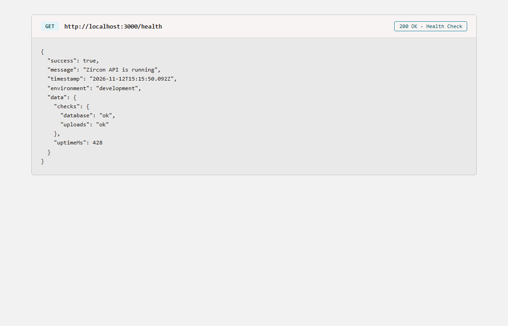
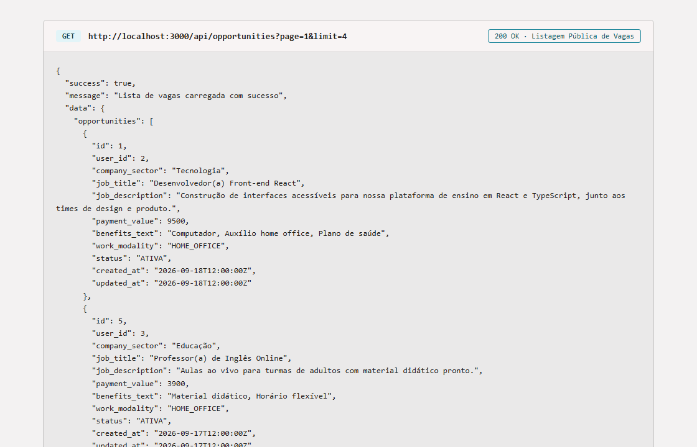
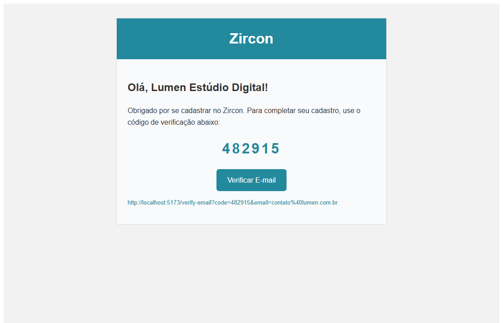
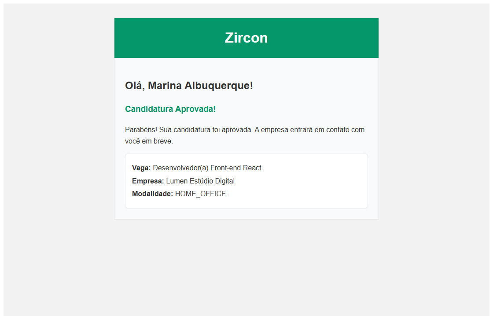

# Manual do Usuário e Operação — Zircon Backend (`backend-zircon`)

Este manual explica passo a passo como configurar, iniciar, verificar e operar a API REST do **Zircon** (`Node.js` + `Express` + `SQLite/Knex`). Os prints abaixo utilizam dados fictícios de demonstração.

---

## 1. Visão Geral da Arquitetura

O `backend-zircon` centraliza toda a lógica de negócios, autenticação, validação de documentos e persistência em SQLite para o painel web (`web-zircon`) e para o aplicativo mobile (`mobile-zircon`):

- **Base URL**: `http://localhost:3000/api`
- **Health Check**: `http://localhost:3000/health`
- **Uploads estáticos**: `http://localhost:3000/uploads/avatars/<arquivo>`
- **Detecção de plataforma**: cabeçalho `x-platform: web` ou `x-platform: mobile`

---

## 2. Configuração Inicial (Passo a Passo)

### Passo 1 — Instalar dependências
```bash
cd backend-zircon
npm install
```

### Passo 2 — Configurar variáveis de ambiente
Copie o arquivo de exemplo:
```bash
cp .env.example .env
```

Principais campos em `.env`:
- `HOST=0.0.0.0`: obrigatório quando for acessar a API pelo emulador Android ou celular na rede local.
- `PORT=3000`: porta HTTP do servidor.
- `BASE_URL=http://localhost:3000`: URL base usada ao montar `avatar_url`.
- `JWT_ACCESS_SECRET` e `JWT_REFRESH_SECRET`: chaves de assinatura dos tokens (`15m` acesso, `7d` refresh).
- `SMTP_HOST`, `SMTP_PORT`, `SMTP_USER`, `SMTP_PASS`: credenciais SMTP para envio dos códigos de verificação, links de recuperação e notificações de candidatura.
- `FRONTEND_WEB_URL=http://localhost:5173`: URL usada nos links de verificação de e-mail e redefinição de senha.
- `CORS_ORIGIN=http://localhost:5173,http://localhost:3000`: origens permitidas pelo navegador.

### Passo 3 — Criar tabelas e usuário administrador inicial
```bash
npm run migrate
npm run seed
```

Credenciais do **usuário inicial** criado pelo seed:
- **E-mail**: `admin@admin.com`
- **Senha**: `Senha123!`
- **Tipo**: `ADMIN` (`verified_email = 1`, `status = ATIVO`)

### Passo 4 — Iniciar o servidor
```bash
npm run dev
```

---

## 3. Verificação da API (`/health` e Endpoints)

### Passo 1 — Conferir o Health Check
Acesse `http://localhost:3000/health` no navegador (ou pelo Insomnia/cURL). O retorno confirma que o Express, o SQLite e o diretório de uploads estão operacionais:



### Passo 2 — Consultar vagas públicas (`GET /api/opportunities`)
A listagem pública retorna apenas vagas com status `ATIVA` e estrutura paginada (`opportunities` + `pagination`):



### Passo 3 — Importar coleção no Insomnia (opcional)
Para testar os endpoints diretamente:
1. Abra o **Insomnia**.
2. Importe o arquivo [Zircon-Insomnia.json](./Zircon-Insomnia.json).
3. Execute primeiro `Login` para obter `accessToken` e `refreshToken` e passe `Authorization: Bearer <token>` nas rotas protegidas.

---

## 4. E-mails Automáticos e Verificação

Sempre que uma conta (`EMPRESA` ou `PROFISSIONAL`) é cadastrada, o backend envia um e-mail com:
1. **Código numérico de 6 dígitos** (`POST /api/auth/verify-email`).
2. **Botão/Link direto** para `${FRONTEND_WEB_URL}/verify-email?code=...&email=...`, que valida automaticamente ao abrir no navegador.



Quando a empresa altera o status de uma candidatura para `EM_ANALISE`, `APROVADA` ou `REJEITADA`, o profissional recebe automaticamente um e-mail informativo:



> **Dica sem SMTP em testes locais**: caso não configure um servidor SMTP real, o cadastro continua funcionando normalmente e o código de 6 dígitos fica salvo na coluna `code_email_verification` da tabela `users` em `backend-zircon/data/zircon.db`.

---

## 5. Regras de Negócio e Fluxo de Dados

1. **Validação de documentos**: CPF, CNPJ e Passaporte são validados no backend no momento do cadastro (`POST /api/auth/register`).
2. **Força de senha**: mínimo de 8 caracteres, com ao menos 1 letra maiúscula, 1 minúscula, 1 número e 1 caractere especial.
3. **Ciclo completo da vaga e candidaturas**:
   - Profissional se candidata (`PENDENTE`) → Empresa inicia análise (`EM_ANALISE`) → Empresa aprova (`APROVADA`).
   - Ao finalizar a vaga (`PUT /api/opportunities/:id` com `status: "FINALIZADA"`):
     - É obrigatório haver pelo menos **1 candidatura `APROVADA`** (se houver mais de uma, informe `winning_application_id`).
     - Todas as demais candidaturas da vaga (`PENDENTE`, `EM_ANALISE` e eventuais outras `APROVADA`) passam automaticamente para `REJEITADA` e recebem e-mail.
     - Uma vaga `FINALIZADA` **não pode ser reaberta nem alterada**.

---

## 6. Comandos de Manutenção

| Comando | O que faz |
|---|---|
| `npm run dev` | Inicia o servidor em modo desenvolvimento com auto-reload |
| `npm run migrate` | Aplica migrations pendentes no SQLite |
| `npm run seed` | Insere o usuário administrador inicial (`admin@admin.com`) |
| `npm run db:reset` | Faz rollback, recria as tabelas e roda o seed novamente |
| `npm test` | Executa a suíte de testes de integração (`Jest` + `Supertest`) |
