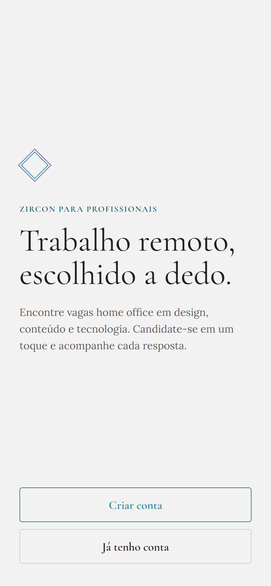
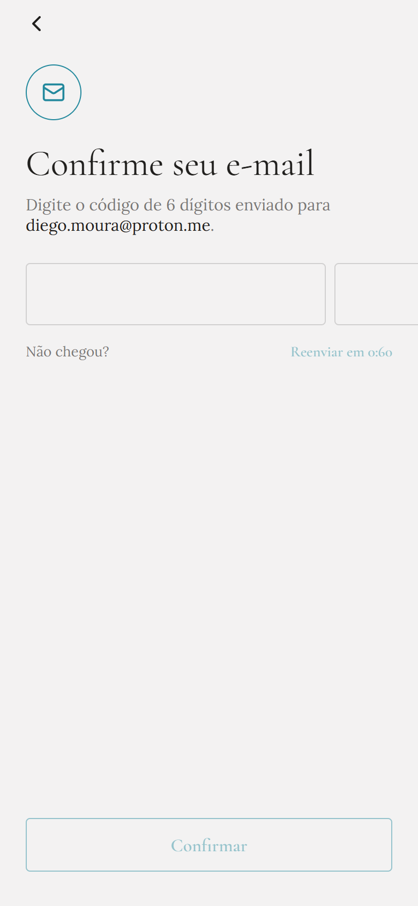
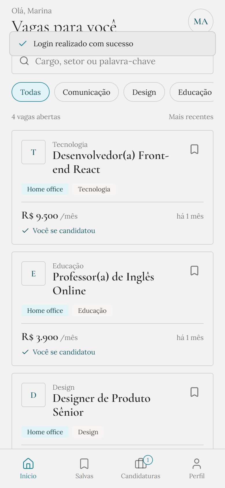
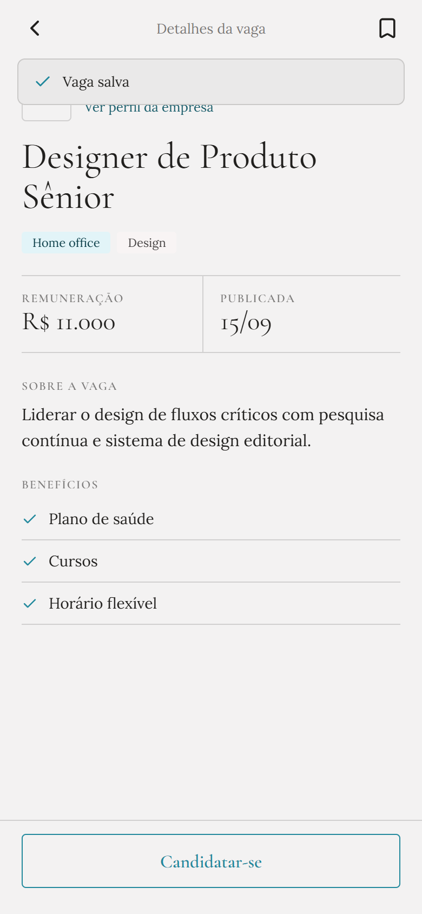
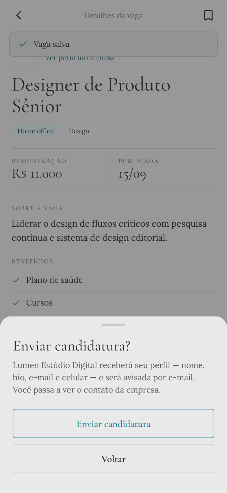
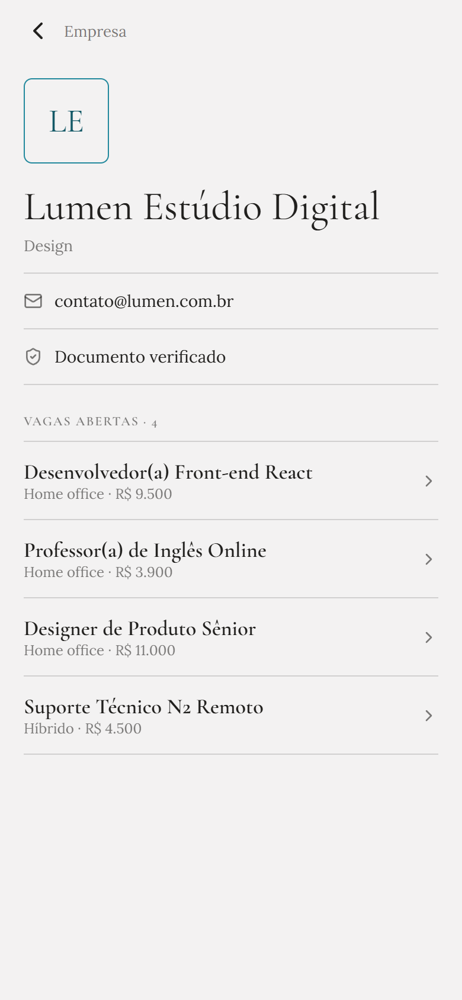
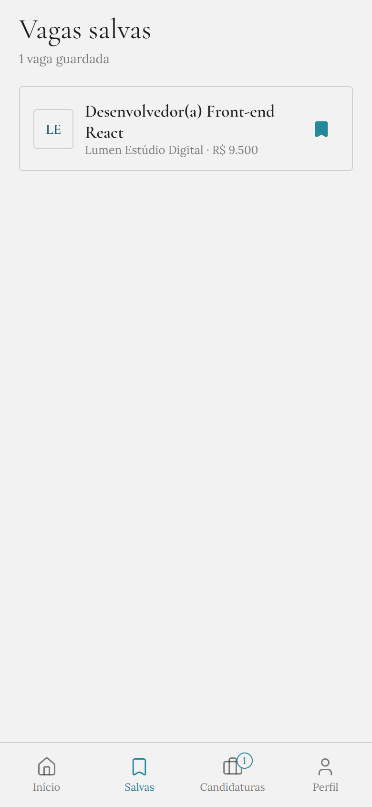
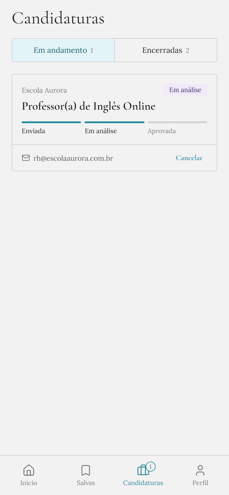
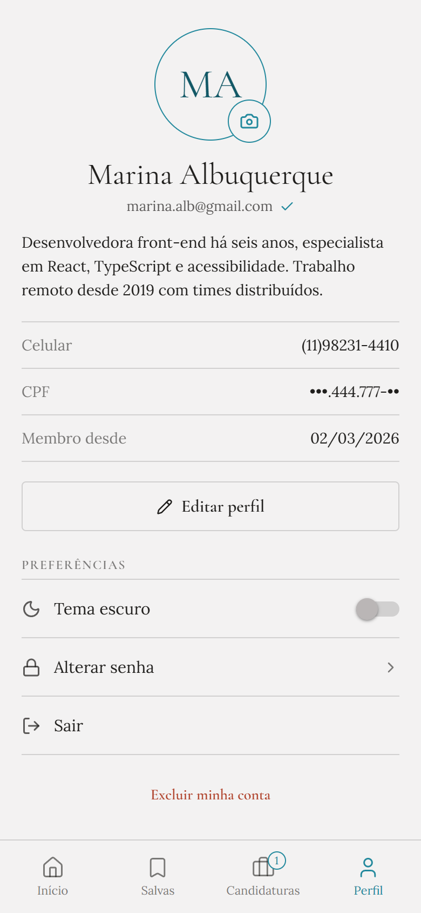
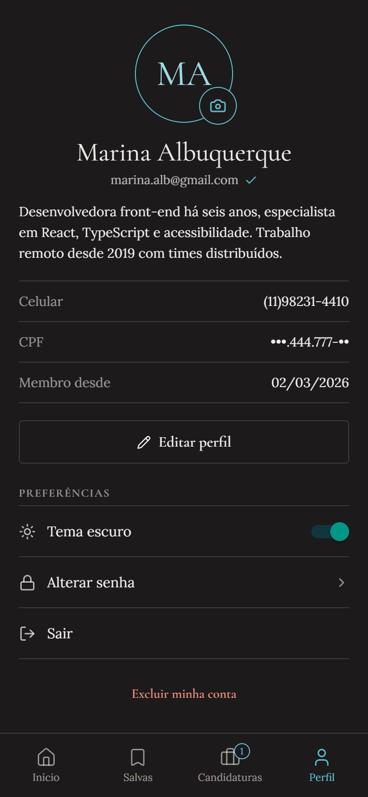

# Manual do Usuário — Aplicativo Mobile Zircon (`mobile-zircon`)

Guia passo a passo do aplicativo **Zircon** em **Expo / React Native**, voltado para **Profissionais** em busca de vagas home office. Os prints abaixo foram capturados com dados fictícios de demonstração.

---

## 1. Primeiros Passos (Boas-vindas, Cadastro e Login)

### 1.1 Tela Inicial
Ao abrir o aplicativo pela primeira vez, escolha entre **Criar conta** (para novos profissionais) ou **Já tenho conta** (para entrar com um cadastro existente).

### 1.2 Criar Conta (Profissional)
1. Toque em **Criar conta**.
2. Preencha **Nome completo**, **CPF** (com máscara automática e validação), **E-mail**, **Celular** e **Senha** (mínimo 8 caracteres, com maiúscula, minúscula, número e caractere especial).
3. Toque em **Criar conta**.

### 1.3 Confirmação de E-mail (Código de 6 Dígitos)
1. Após o cadastro (ou ao tentar entrar com uma conta pendente), o app abre a tela **Confirme seu e-mail**.
2. Digite os **6 dígitos** recebidos no seu e-mail e toque em **Confirmar**.
3. Caso o código não chegue, aguarde o contador e toque em **Reenviar código**.

### 1.4 Entrar
1. Na tela **Entrar**, informe seu **E-mail** e **Senha** e toque em **Entrar**.
2. Se esquecer a senha, toque em **Esqueci minha senha**, informe seu e-mail para receber o token e defina uma nova senha no modal.

> Contas do tipo `EMPRESA` ou `ADMIN` são orientadas a acessar pelo painel web (`web-zircon`).

---

## 2. Explorando Vagas e Enviando Candidaturas

### 2.1 Aba *Início*
- **Busca**: pesquise por cargo, setor ou palavra-chave no campo superior.
- **Filtro por setor**: deslize e toque nos chips (*Todas*, *Tecnologia*, *Design*, *Educação*, etc.).
- **Atualizar e paginação**: puxe a lista para baixo (*pull-to-refresh*) para atualizar e role até o final para carregar novas páginas.
- **Salvar vaga**: toque no ícone de marcador no canto superior direito de qualquer card para guardar a vaga.
- Vagas às quais você já se candidatou exibem o indicador **✓ Você se candidatou**.

### 2.2 Detalhes da Vaga e Envio de Candidatura
1. Toque em um card para abrir os **Detalhes da vaga** (remuneração, data de publicação, descrição completa e lista de benefícios).
2. Para se inscrever, toque em **Candidatar-se** na barra inferior.

3. Confirme no painel inferior (**Enviar candidatura?**) — a empresa receberá seu perfil (nome, bio, e-mail e celular) e será notificada por e-mail.

> Caso você abra uma vaga salva depois que a empresa a finalizou, pausou ou cancelou, o botão ficará bloqueado com o status correspondente (por exemplo, **Vaga finalizada**).

### 2.3 Perfil da Empresa
Na tela da vaga, toque em **Ver perfil da empresa** para visualizar informações da contratante e outras vagas abertas por ela. O e-mail direto da empresa aparece automaticamente após você ter se candidatado a alguma vaga dela.

---

## 3. Vagas Salvas e Acompanhamento de Candidaturas

### 3.1 Aba *Salvas*
Reúne localmente (por usuário logado neste aparelho) todas as vagas que você marcou. Toque no card para abrir a vaga ou no ícone de marcador para remover da lista.

### 3.2 Aba *Candidaturas*
Acompanhe todas as suas inscrições divididas em duas sub-abas:
- **Em andamento**: candidaturas com status `Pendente` ou `Em análise`, mostrando a barra visual de progresso (*Enviada → Em análise → Aprovada*) e o botão **Cancelar** caso deseje desistir.
- **Encerradas**: candidaturas já `Aprovada`, `Rejeitada` (inclusive quando a empresa finaliza a vaga com outro candidato) ou `Cancelada`.

---

## 4. Perfil, Foto, Tema Escuro e Conta

Na aba **Perfil**:
1. **Foto de avatar**: toque no ícone de câmera sobre o círculo de iniciais/foto para escolher uma imagem da galeria e enviá-la ao servidor.
2. **Editar perfil**: toque em **Editar perfil** para atualizar seu nome completo, celular e biografia profissional.
3. **Preferências**:
   - **Tema escuro**: ative ou desative o switch para alternar instantaneamente entre modo claro e escuro.
   - **Alterar senha**: abre o formulário para trocar a senha atual.
   - **Sair**: encerra a sessão neste aparelho (removendo os tokens do `SecureStore`).
   - **Excluir minha conta**: desativa sua conta após confirmação.

Visualização da aba **Perfil** com o **Tema escuro** ativado:

