# Manual do Usuário — Painel Web Zircon (`web-zircon`)

Guia passo a passo de uso do painel web do **Zircon** (`http://localhost:5173`), destinado a **Empresas** (publicação e seleção de vagas home office) e **Administradores** (gestão de usuários e moderação). Todos os prints utilizam dados fictícios de demonstração.

---

## 1. Acesso e Cadastro

### 1.1 Tela de Login
1. Acesse `http://localhost:5173`.
2. Informe seu **E-mail** e **Senha** e clique em **Entrar**.
3. Caso precise testar rapidamente como administrador inicial, clique em **Preencher Admin** (`admin@admin.com` / `Senha123!`).
4. Atalhos disponíveis na tela:
   - **Esqueci a senha**: envia um token/link de redefinição para o e-mail.
   - **Verificar e-mail / Reenviar código**: permite confirmar ou pedir um novo código para contas pendentes.
   - **Cadastrar empresa**: abre o formulário de registro para novas empresas.

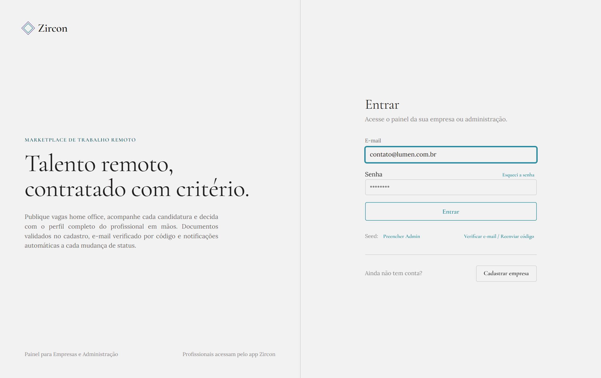

> Contas do tipo `PROFISSIONAL` são orientadas a utilizar o aplicativo mobile (`mobile-zircon`).

### 1.2 Cadastrar Empresa
1. Clique em **Cadastrar empresa**.
2. Selecione o **Tipo de documento** (`CNPJ`, `CPF` ou `Passaporte`) — o número é validado antes do envio.
3. Preencha **Razão social ou nome**, **E-mail**, **Telefone** e **Senha** (mínimo 8 caracteres com maiúscula, minúscula, número e símbolo).
4. Clique em **Criar conta**.

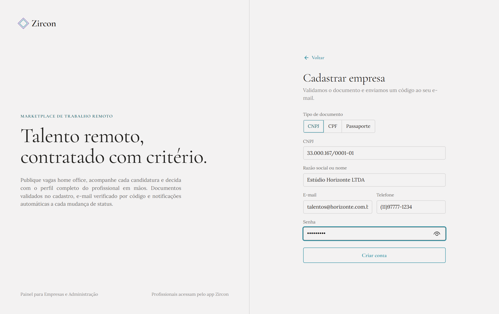

### 1.3 Verificação de E-mail (Código de 6 Dígitos ou Link)
1. Após o cadastro, o sistema direciona automaticamente para `/verify-email` e envia um e-mail com o código de 6 dígitos e um botão **Verificar E-mail**.
2. Você pode **clicar no link recebido no e-mail** (verificação automática) **ou** digitar/colar os 6 dígitos nos campos abaixo e clicar em **Confirmar código**.
3. Se o código expirar ou não chegar, informe o e-mail no campo **E-mail da conta** e clique em **Enviar código** (intervalo de 60 segundos entre reenvios).

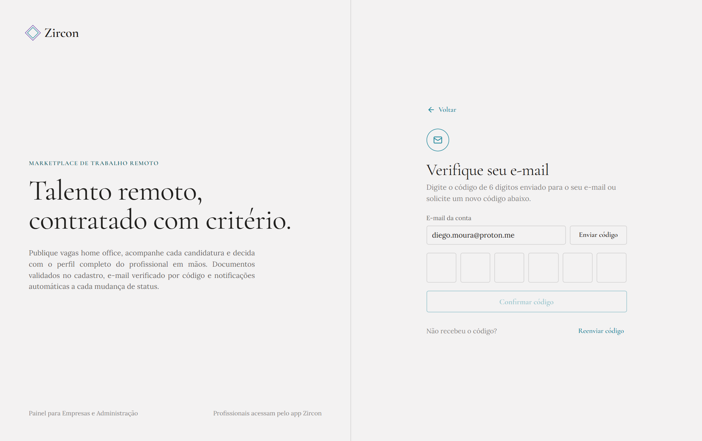

---

## 2. Fluxo da Empresa (`EMPRESA`)

### 2.1 Dashboard (Visão Geral)
Ao entrar como empresa, o **Dashboard** exibe:
- **4 indicadores principais**: *Vagas ativas*, *Candidaturas*, *Aguardando* (pendentes) e *Aprovadas* (com contagem de vagas finalizadas).
- **Candidaturas recentes**: clique em qualquer linha para abrir a ficha completa do candidato.
- **Status das vagas**: barras proporcionais por status (*Ativa*, *Pausada*, *Finalizada*, *Cancelada*).

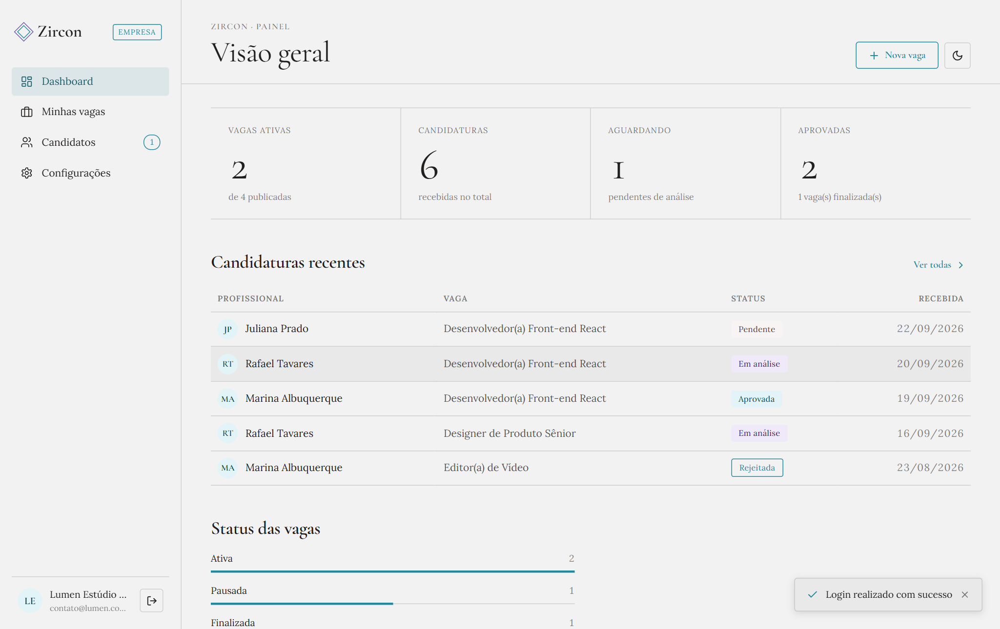

### 2.2 Publicar e Gerenciar Vagas (*Minhas vagas*)
1. No menu lateral, clique em **Minhas vagas**.
2. Utilize os filtros superiores por status (*Todas*, *Ativa*, *Pausada*, *Finalizada*, *Cancelada*) ou a barra de busca por título/setor.
3. Na coluna **Candidatos**, clique no número para abrir a lista de inscritos filtrada por aquela vaga.
4. Ações por linha:
   - **Pausar / Reativar**: alterna a visibilidade da vaga no app mobile.
   - **Finalizar**: aparece automaticamente quando a vaga possui ao menos **1 candidatura aprovada**.
   - **Editar** (lápis) / **Excluir** (lixeira): disponíveis enquanto a vaga não estiver finalizada.

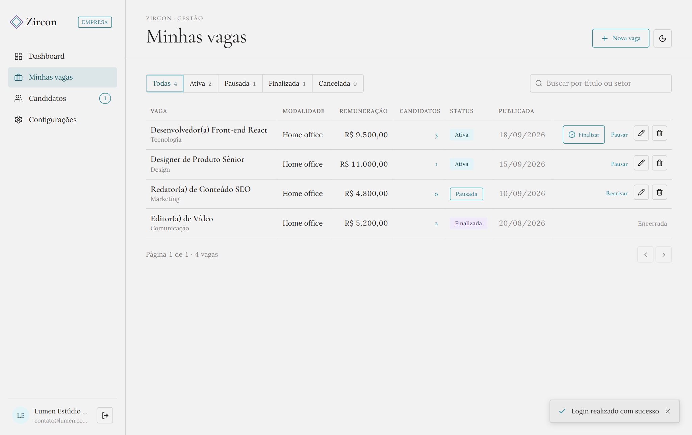

Para criar uma nova vaga:
1. Clique em **+ Nova vaga** no topo direito.
2. Preencha **Título da vaga**, **Setor**, **Remuneração mensal (R$)**, **Modalidade** (*Home office*, *Híbrido* ou *Presencial*), **Descrição** e **Benefícios**.
3. Opcionalmente marque **Salvar como pausada** para publicar como rascunho.
4. Clique em **Publicar vaga**.

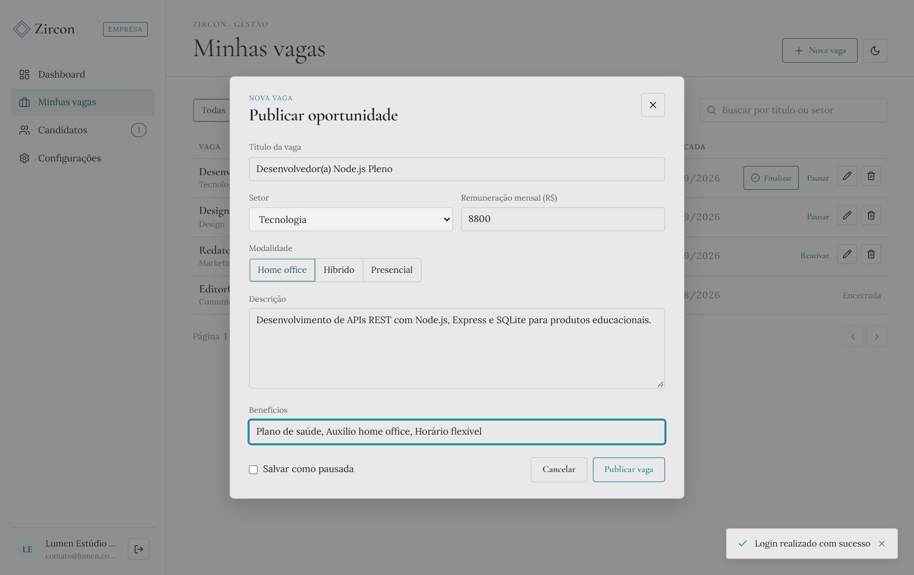

### 2.3 Avaliar Candidatos (*Candidatos*)
1. Acesse **Candidatos** no menu lateral (o número ao lado indica quantas candidaturas estão pendentes).
2. Filtre por status (*Todas*, *Pendente*, *Em análise*, *Aprovada*, *Finalizadas*, *Rejeitada*) ou selecione uma vaga específica no seletor à direita.
3. Clique em qualquer linha para abrir o modal de avaliação.

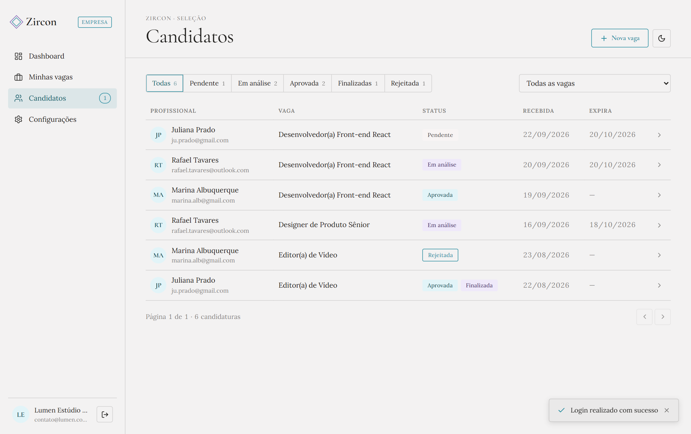

No **Modal de Avaliação**:
- À esquerda ficam a **bio**, **e-mail** e **telefone** do profissional.
- À direita ficam os **detalhes da vaga** e a linha do tempo em **Histórico** (`Candidatura enviada → Em análise → Aprovada → Finalizar vaga`).
- No rodapé, conduza o processo em sequência:
  1. **Iniciar análise** (muda para `EM_ANALISE` e notifica por e-mail).
  2. **Aprovar candidatura** ou **Rejeitar** (muda para `APROVADA` ou `REJEITADA` e notifica por e-mail).
  3. Quando a candidatura já estiver **Aprovada**, clique em **Finalizar vaga com este candidato** para concluir a vaga diretamente dali.

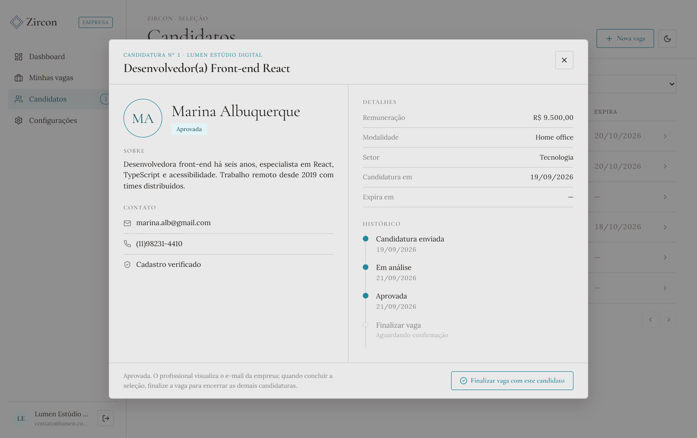

### 2.4 Finalizar a Vaga
1. Ao clicar em **Finalizar** (na tabela *Minhas vagas* ou no modal de avaliação), abre-se o modal **Finalizar vaga**.
2. Se houver mais de uma candidatura aprovada para a vaga, selecione qual profissional permanecerá aprovado com sucesso.
3. Clique em **Confirmar finalização**:
   - A vaga passa para `FINALIZADA` e **não pode mais ser reaberta ou editada**.
   - O candidato selecionado permanece `APROVADA`.
   - Todas as demais candidaturas (`PENDENTE`, `EM_ANALISE` ou outras aprovadas) são encerradas automaticamente como `REJEITADA` e notificadas por e-mail.

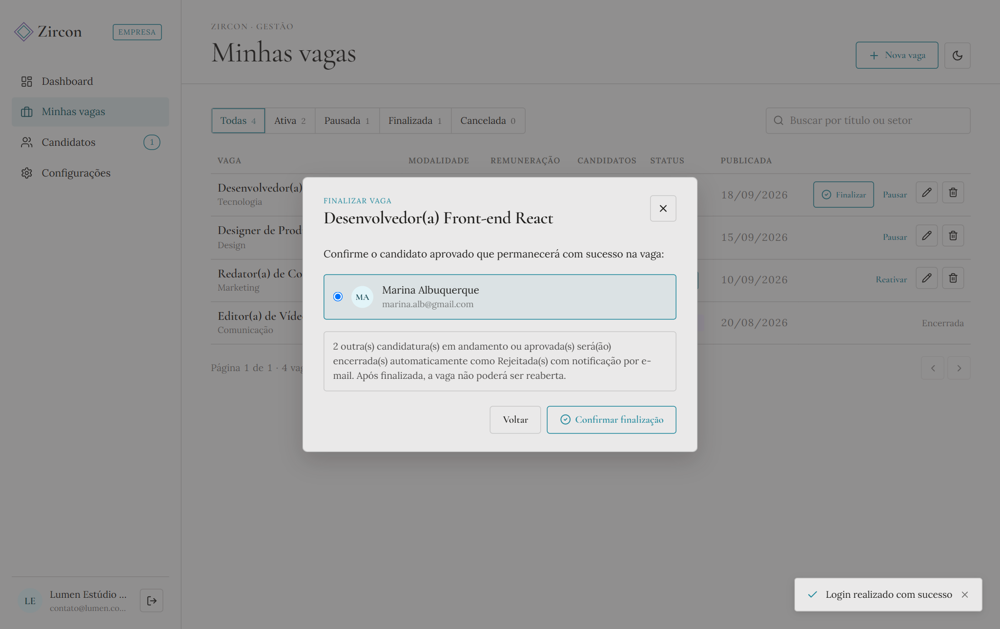

---

## 3. Configurações, Avatar e Tema Escuro

Em **Configurações** no menu lateral:
- **Perfil**: clique em **Alterar imagem** para enviar o logo/foto (`JPEG`, `PNG` ou `WebP`, até `5 MB`), edite **Nome / Razão social**, **Telefone** e **Sobre** e clique em **Salvar perfil**.
- **Senha**: informe a senha atual e defina uma nova senha forte.
- **Sessão**: visualize a validade do token de acesso (`15 min`), clique em **Renovar agora**, **Encerrar sessão** ou **Excluir conta**.

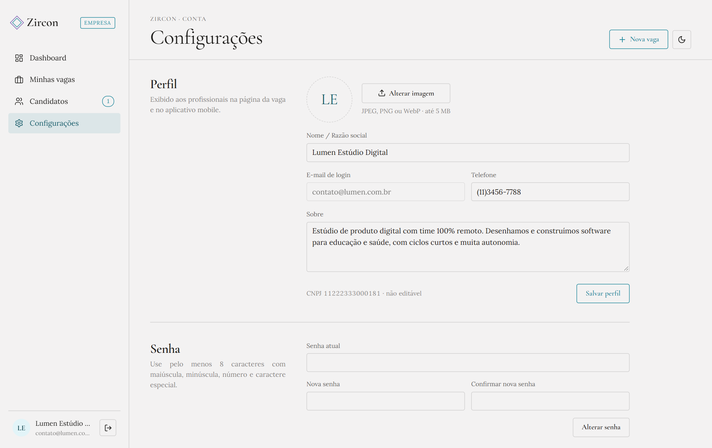

Para alternar entre **tema claro e tema escuro**, clique no ícone de lua/sol no canto superior direito do painel:

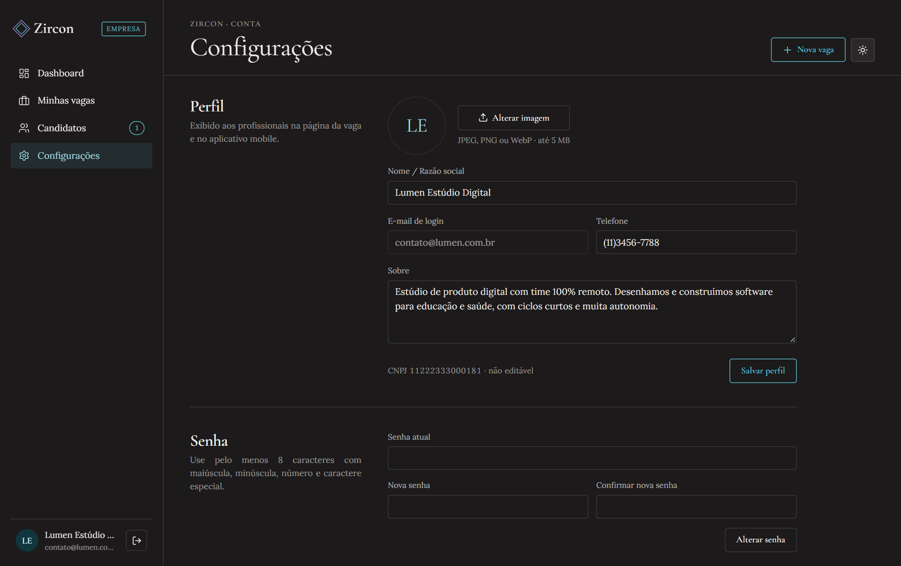

---

## 4. Fluxo do Administrador (`ADMIN`)

Ao entrar com a conta administradora (`admin@admin.com` / `Senha123!`):
- **Dashboard**: mostra os totais da plataforma (*Usuários ativos*, *Empresas*, *Profissionais* e *Vagas ativas*) além da *Distribuição de usuários*.

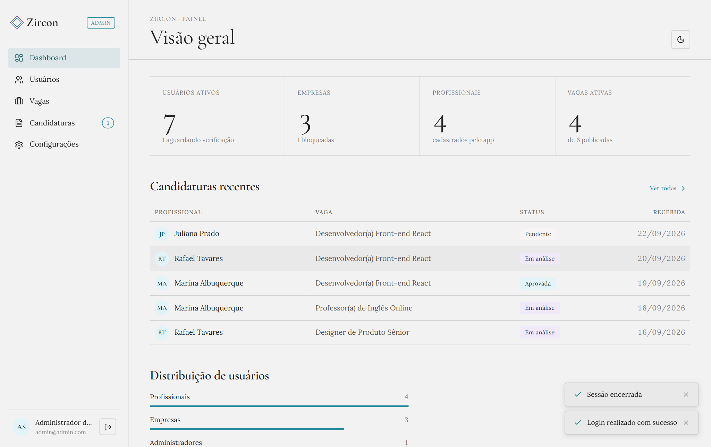

- **Usuários**: permite filtrar por perfil (*Todos*, *Empresas*, *Profissionais*, *Admin*), buscar por nome, e-mail ou documento, acompanhar se o e-mail está verificado e **Bloquear / Desbloquear** contas quando necessário.
- **Vagas e Candidaturas**: o administrador visualiza todas as vagas e candidaturas da plataforma e pode moderar status (respeitando a regra de que vagas `FINALIZADA` não são reabertas).

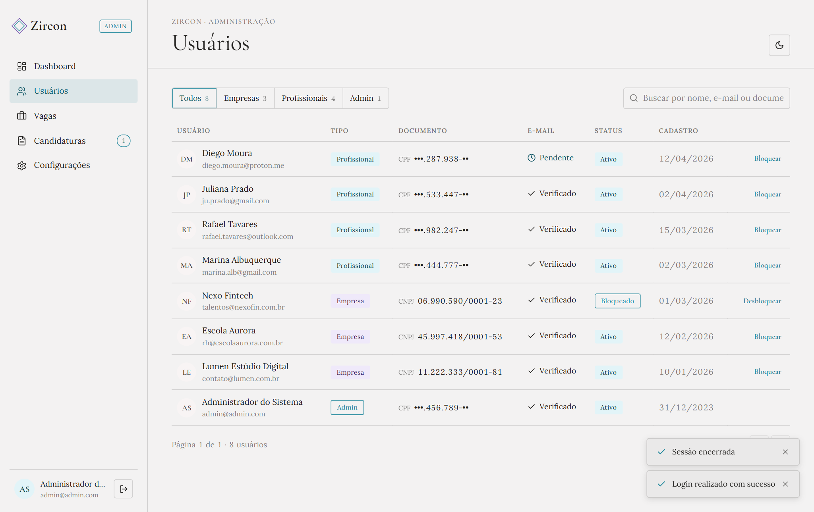
